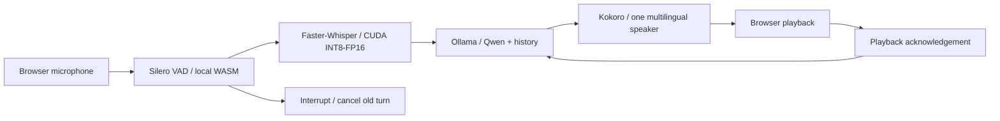

# Local Voice

A local Hindi, English, and Hinglish voice companion built for the Trikon Software Labs AI internship assignment.
Speak naturally, ask a follow-up, or interrupt a reply. All speech recognition, language
generation, voice synthesis, and voice activity detection run on your machine.

**React + TypeScript · FastAPI · Faster-Whisper · Ollama/Qwen · Kokoro · Silero VAD**


[Preview the signup screen](docs/signup.png) · [Design and account flow](docs/account-experience.md)

## Run on Windows

Tested with Windows, an Intel i7-13620H, 16 GB RAM, and Node 24.
Speech recognition and synthesis use the NVIDIA GPU when available, with CPU fallbacks.
Ollama selects an available accelerator. The tested GPU is an RTX 4060 Laptop (8 GB).
Use headphones and a microphone. Reserve several GB of disk space for dependencies
and model downloads. No API keys or paid inference services are needed.

Prerequisites: [uv](https://docs.astral.sh/uv/getting-started/installation/),
[Node.js 24 LTS](https://nodejs.org/), [Ollama](https://ollama.com/download), and Chrome/Edge.
Keep the Ollama application running. FFmpeg is needed only to export the automated demo.

From PowerShell in this repository:

```powershell
.\scripts\setup.ps1
.\scripts\start.ps1
```

Open **http://127.0.0.1:8000**. Choose **Get started** to create a local account, or
**Log in** to return to your workspace. Use a password of at least 12 characters.
Wait for “All models local,” then click **Start conversation**
and allow microphone access. Pause to send a turn; speak again to interrupt. End conversation
releases the microphone. Clear conversation resets the transcript and context.
Interruption stops playback at the first speech detection while keeping the full
recording. Uncertain recognition asks you to repeat instead of accepting a low-confidence
guess as a new message; genuine "thank you" is still accepted.

Accounts are stored only in `data/accounts.sqlite3` (ignored by Git). Passwords use
salted scrypt hashes; seven-day sessions use revocable HttpOnly/SameSite cookies.
Email is a local identifier: there is no verification, email delivery or password
recovery. Conversations remain in the current session and are not saved to accounts.
Keep `data/` if you want to retain accounts when moving or backing up the project.
The server binds to loopback; this account system is intended for this local app.

The landing page, sign-up, login and voice workspace share the supplied purple desert
background. Pause/play controls and reduced-motion support are available throughout.
See [the account experience plan](docs/account-experience.md) for the flow and checks.

For authenticated benchmark, language-check and demo scripts, first create an account
in the UI, then set `LOCALVOICE_EMAIL` and `LOCALVOICE_PASSWORD` in your terminal's
environment. Scripts log in with that account; credentials are not written to files.
Clear those environment variables after use. Browser tests create their own test account.

Speak Hindi for Hindi replies, English for English replies, or mix both for Hinglish.
You can also ask explicitly to answer in a particular language. Hindi appears in
Devanagari in the transcript and replies; English words can appear alongside it.
The assistant infers reply language from your latest utterance and conversation context.
Use **Auto**, **English**, or **Hindi / Hinglish** above the transcript to choose the
recognition mode. Auto considers English and Hindi only. Unsupported scripts are
rejected before display or memory; recognition errors let you retry without restarting
the microphone. Detected Hindi is displayed in Devanagari, not Tamil or Roman Hindi.
For Hinglish, it checks that a reply contains both scripts before starting speech;
a single-language draft gets one short, relevant continuation in the missing language,
or a retry error is shown. This fallback mixes languages between sentences.

Setup creates `.venv` with Python 3.11, installs locked dependencies, downloads speech models,
ensures the Ollama model exists, and builds React. Normal startup does not download assets.
The first setup requires internet; the application works offline after setup.
On Windows with an NVIDIA GPU, setup also installs the pinned CUDA 12/cuDNN 9 runtime
from `requirements-gpu.lock` into `.venv` (approximately 1.8 GB download). DLL discovery
changes only the application process. No system-wide CUDA or PATH modification is needed.
For CPU-only installation, use `scripts/setup.ps1 -CpuOnly`. To force CPU recognition,
set `$env:STT_DEVICE='cpu'` before starting; the interface reports the slower small-model
fallback explicitly. This profile does not carry the GPU latency target.

If PowerShell blocks local scripts, run the equivalent manual commands below rather than
changing your machine's execution policy.

<details>
<summary>Manual installation</summary>

```powershell
uv venv --python 3.11 .venv
uv pip sync --python .venv/Scripts/python.exe --reinstall-package onnxruntime requirements.lock
uv pip install --python .venv/Scripts/python.exe --reinstall-package onnxruntime-gpu -r requirements-gpu.lock
.venv/Scripts/python scripts/setup_models.py
ollama pull qwen3:4b-instruct-2507-q4_K_M
cd frontend
npm ci
npm run build
cd ..
.venv/Scripts/python -m uvicorn app.main:app --host 127.0.0.1 --port 8000 --ws-max-size 1300000
```

</details>

## How it works



The browser sends 16 kHz mono PCM after 600 ms of silence. FastAPI transcribes it,
streams LLM text, and synthesizes completed sentences concurrently. At most two speech
chunks can run ahead of playback. Turn IDs prevent stale results from playing after an
interruption. History includes completed spoken chunks rather than unheard generated text.

Native STT/TTS calls run in separate single-worker executors. Python cancellation cannot
preempt a native call, so it may finish in the background, but its result is discarded.
Six recent turn pairs are retained with an additional conservative character budget;
the model context is capped at 4,096 tokens. No conversation is stored on disk.

See [architecture and protocol](docs/architecture.md), [measurements](docs/performance.md),
and [review findings and verification](docs/review.md).

## Models and measurements

The current 30-turn Chrome benchmark measured **2.38s median / 3.70s p95** from
estimated speech end to first playback, meeting the 3s / 5s target on this laptop.
It uses synthetic microphone speech with real local inference and browser playback.
See [method, per-language results and historical baselines](docs/performance.md).

| Stage | Model / configuration | Reason |
|---|---|---|
| STT | Multilingual `medium`, CUDA INT8-FP16, beam 1; `small` CPU INT8 fallback | English/Hindi-only language selection and explicit manual input modes |
| LLM | `qwen3:4b-instruct-2507-q4_K_M`, 192-token reply cap | Separate structured language selection followed by a streamed reply |
| TTS | Kokoro / Omega, 24,000 Hz, CUDA FP32 or CPU INT8 | One fixed speaker for English, Hindi and Hinglish; pronunciation changes by script |
| VAD | Silero v5 via `vad-web` 0.0.31 / local ONNX WASM | Automatic endpointing and spoken interruptions |

Initial English-only (`base.en`) ten-turn synthetic-speech benchmark on this laptop: **4.24 s median / 6.79 s p95
to first audio received**, excluding VAD and playback. Model initialization and warmup
took **8.15 s**. These are observations from one run, not guarantees. The browser's
timing panel measures first playback separately. The small LLM can give incorrect answers;
the benchmark includes an example, documented in the results.

Those initial measurements predate Hindi support. The multilingual model is larger
(about 1.53 GB of weights) and takes longer on CPU. Recognition of accents, short
utterances, and code-switching is imperfect; language matching is model-guided, not a guarantee.
English, Hindi and mixed replies now use the same Kokoro Omega speaker. Language-specific
pronunciation is combined before synthesis, so mixed sentences retain one speaker.
Piper remains only for synthetic test inputs; its Hindi dataset has noncommercial terms
(see [model notices](docs/models.md)). Human listening remains necessary to judge accent quality.

## Development and tests

Backend:

```powershell
.venv/Scripts/python -m uvicorn app.main:app --host 127.0.0.1 --port 8000
.venv/Scripts/python -m pytest -q
.venv/Scripts/python -m ruff check .
```

Frontend, in another terminal:

```powershell
cd frontend
npm run dev
npm run test -- --run
npm run lint
npm run build
```

Vite serves http://127.0.0.1:5173 and proxies the backend. Production uses port 8000 only.
After rebuilding the frontend, reload the browser. Restart the backend if it was launched
before the first frontend build.

Integration tests use **real local inference and synthetic microphone fixtures**:

```powershell
.venv/Scripts/python scripts/make_fixtures.py
cd frontend
npm run test:e2e
```

Keep the backend running for E2E tests; Google Chrome must be installed. Tests cover the
complete speech pipeline, spoken interruptions, responsive layouts, and automated
accessibility checks. Real accent/noise/headphone testing is still a manual check.

For a synthetic English → Hindi → Hinglish → English language-switching check,
including an explicit English override spoken in Hindi:

```powershell
.venv/Scripts/python scripts/check_languages.py
```

This uses real local STT/LLM/TTS and writes transcripts, replies, timings, and script
checks to `artifacts/language-check.json`, plus generated audio. It does not test a human accent.

## Benchmark and demo

Browser first-playback benchmark for the GPU profile (30 synthetic turns, ten per
language style, three additional warmups excluded):

```powershell
.venv/Scripts/python scripts/make_latency_fixtures.py
cd frontend
node scripts/benchmark-playback.mjs
```

Results are written to `artifacts/latency/playback-results.json`. This includes VAD,
actual browser decode and playback start; it does not measure acoustic output from
the headset. The app estimates speech end from the last positive VAD frame. Fixtures
are synthetic and do not establish human accent/noise accuracy. The script exits
with failure if median first playback exceeds 3 seconds or p95 exceeds 5 seconds.
Keep other inference tests idle while measuring. CPU fallback has a separate profile.

```powershell
.venv/Scripts/python scripts/benchmark.py
```

Raw results go to `artifacts/benchmark.json`. Prompts are synthesized by Piper; this is
reproducible integration evidence, not a representative human-speech accuracy evaluation.

The generated **2-minute demonstration video** is `artifacts/local-voice-demo.mp4` when
present. It is explicitly labelled as an automated synthetic-microphone showcase using
real local inference. [Reproduction and human-demo guide](docs/demo.md).
That existing video predates the light-workspace redesign; the README screenshot and
current browser verification reflect the new interface.

## Troubleshooting and limits

- **Setup needed:** read the error on screen, run model setup, ensure Ollama is running,
  then restart the backend. Check http://127.0.0.1:8000/api/health.
- **No microphone:** allow access in the browser, check Windows privacy settings, and
  close other apps holding the device. Use localhost rather than a LAN IP.
- **False interruptions:** wear headphones; speaker echo suppression is not guaranteed.
- **Slow answers:** close memory/CPU-heavy applications. The timing panel shows whether
  STT, generation, or synthesis is responsible. Models must be warm for warm comparisons.
- **Long speech:** recordings are capped at 30 seconds; restart with a shorter utterance.
- **Model change:** set `OLLAMA_MODEL` before startup. Changing models requires rechecking
  supported thinking settings, latency, memory and response quality.
- One local user, Hindi/English/Hinglish, session memory. No tool use, RAG, speaker identification,
  or true streaming STT. Interruptions discard the currently playing partial sentence from
  memory; complete acknowledged chunks remain.

## Source and model licenses

Project source is GPL-3.0-or-later; see [LICENSE](LICENSE). Third-party packages and model
weights retain their own licenses. See [model and dependency notices](docs/models.md),
including the Lessac voice dataset license linked from its model card. Model weights are
downloaded separately and are not included in Git.

The repository is ready to push to a GitHub repository of your choice. No remote repository
has been created or published by setup.
