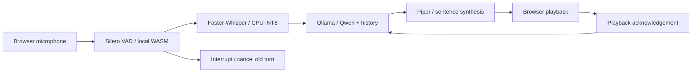

# Local Voice

A local English voice companion built for the Trikon Software Labs AI internship assignment.
Speak naturally, ask a follow-up, or interrupt a reply. All speech recognition, language
generation, voice synthesis, and voice activity detection run on your machine.

**React + TypeScript · FastAPI · Faster-Whisper · Ollama/Qwen · Piper · Silero VAD**


## Run on Windows

Tested with Windows, an Intel i7-13620H, 16 GB RAM, Node 24, and CPU inference.
Use headphones and a microphone. Reserve several GB of disk space for dependencies
and model downloads. No API keys or paid inference services are needed.

Prerequisites: [uv](https://docs.astral.sh/uv/getting-started/installation/),
[Node.js 24 LTS](https://nodejs.org/), [Ollama](https://ollama.com/download), and Chrome/Edge.
Keep the Ollama application running. FFmpeg is needed only to export the automated demo.

From PowerShell in this repository:

```powershell
.\scripts\setup.ps1
.\scripts\start.ps1
```

Open **http://127.0.0.1:8000**. Wait for “All models local,” then click **Start conversation**
and allow microphone access. Pause to send a turn; speak again to interrupt. End conversation
releases the microphone. Clear conversation resets the transcript and context.

Setup creates `.venv` with Python 3.11, installs locked dependencies, downloads speech models,
ensures the Ollama model exists, and builds React. Normal startup does not download assets.
The first setup requires internet; the application works offline after setup.

If PowerShell blocks local scripts, run the equivalent manual commands below rather than
changing your machine's execution policy.

<details>
<summary>Manual installation</summary>

```powershell
uv venv --python 3.11 .venv
uv pip sync --python .venv/Scripts/python.exe requirements.lock
.venv/Scripts/python scripts/setup_models.py
ollama pull qwen3.5:2b-q4_K_M
cd frontend
npm ci
npm run build
cd ..
.venv/Scripts/python -m uvicorn app.main:app --host 127.0.0.1 --port 8000 --ws-max-size 1300000
```

</details>

## How it works



The browser sends 16 kHz mono PCM after 600 ms of silence. FastAPI transcribes it,
streams LLM text, and synthesizes completed sentences concurrently. At most two speech
chunks can run ahead of playback. Turn IDs prevent stale results from playing after an
interruption. History includes completed spoken chunks rather than unheard generated text.

Native STT/TTS calls run in separate single-worker executors. Python cancellation cannot
preempt a native call, so it may finish in the background, but its result is discarded.
Six recent turn pairs are retained with an additional conservative character budget;
the model context is capped at 4,096 tokens. No conversation is stored on disk.

See [architecture and protocol](docs/architecture.md), [measurements](docs/performance.md),
and [review findings and verification](docs/review.md).

## Models and measurements

| Stage | Model / configuration | Reason |
|---|---|---|
| STT | Faster-Whisper `base.en`, INT8, six CPU threads, beam 1 | Small English model with a practical CPU footprint |
| LLM | `qwen3.5:2b-q4_K_M`, thinking disabled, 128-token reply cap | Reuses an installed small open-weight model |
| TTS | Piper `en_US-lessac-medium`, 22,050 Hz | Local CPU voice synthesis |
| VAD | Silero v5 via `vad-web` 0.0.31 / local ONNX WASM | Automatic endpointing and spoken interruptions |

Initial ten-turn synthetic-speech benchmark on this laptop: **4.24 s median / 6.79 s p95
to first audio received**, excluding VAD and playback. Model initialization and warmup
took **8.15 s**. These are observations from one run, not guarantees. The browser's
timing panel measures first playback separately. The small LLM can give incorrect answers;
the benchmark includes an example, documented in the results.

## Development and tests

Backend:

```powershell
.venv/Scripts/python -m uvicorn app.main:app --host 127.0.0.1 --port 8000
.venv/Scripts/python -m pytest -q
.venv/Scripts/python -m ruff check .
```

Frontend, in another terminal:

```powershell
cd frontend
npm run dev
npm run test -- --run
npm run lint
npm run build
```

Vite serves http://127.0.0.1:5173 and proxies the backend. Production uses port 8000 only.
After rebuilding the frontend, reload the browser. Restart the backend if it was launched
before the first frontend build.

Integration tests use **real local inference and synthetic microphone fixtures**:

```powershell
.venv/Scripts/python scripts/make_fixtures.py
cd frontend
npm run test:e2e
```

Keep the backend running for E2E tests; Google Chrome must be installed. Tests cover the
complete speech pipeline, spoken interruptions, responsive layouts, and automated
accessibility checks. Real accent/noise/headphone testing is still a manual check.

## Benchmark and demo

```powershell
.venv/Scripts/python scripts/benchmark.py
```

Raw results go to `artifacts/benchmark.json`. Prompts are synthesized by Piper; this is
reproducible integration evidence, not a representative human-speech accuracy evaluation.

The generated **2-minute demonstration video** is `artifacts/local-voice-demo.mp4` when
present. It is explicitly labelled as an automated synthetic-microphone showcase using
real local inference. [Reproduction and human-demo guide](docs/demo.md).

## Troubleshooting and limits

- **Setup needed:** read the error on screen, run model setup, ensure Ollama is running,
  then restart the backend. Check http://127.0.0.1:8000/api/health.
- **No microphone:** allow access in the browser, check Windows privacy settings, and
  close other apps holding the device. Use localhost rather than a LAN IP.
- **False interruptions:** wear headphones; speaker echo suppression is not guaranteed.
- **Slow answers:** close memory/CPU-heavy applications. The timing panel shows whether
  STT, generation, or synthesis is responsible. Models must be warm for warm comparisons.
- **Long speech:** recordings are capped at 30 seconds; restart with a shorter utterance.
- **Model change:** set `OLLAMA_MODEL` before startup. Changing models requires rechecking
  supported thinking settings, latency, memory and response quality.
- One local user, English, session memory. No Hindi, tool use, RAG, speaker identification,
  or true streaming STT. Interruptions discard the currently playing partial sentence from
  memory; complete acknowledged chunks remain.

## Source and model licenses

Project source is GPL-3.0-or-later; see [LICENSE](LICENSE). Third-party packages and model
weights retain their own licenses. See [model and dependency notices](docs/models.md),
including the Lessac voice dataset license linked from its model card. Model weights are
downloaded separately and are not included in Git.

The repository is ready to push to a GitHub repository of your choice. No remote repository
has been created or published by setup.
