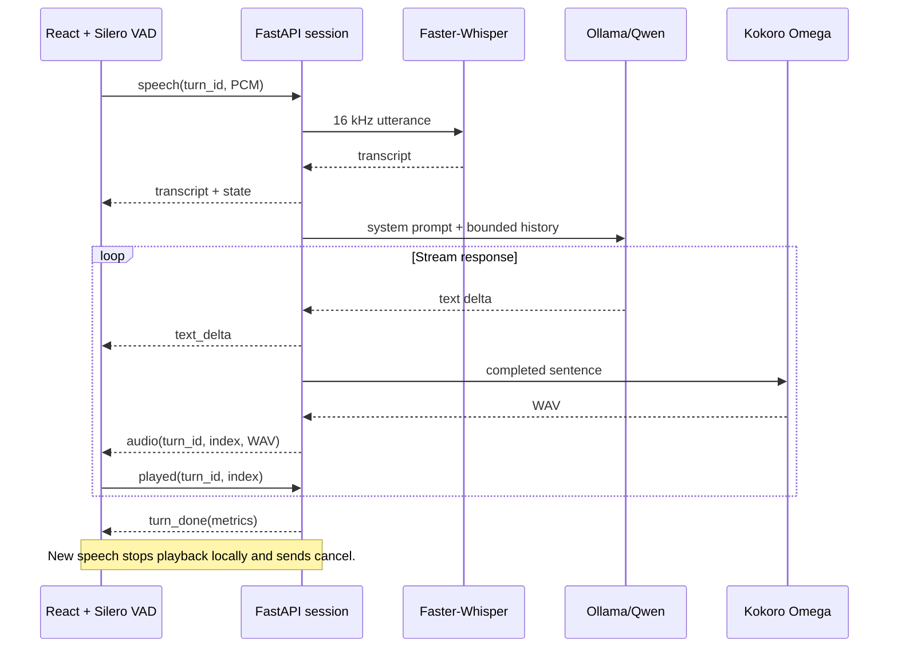

# Architecture and protocol

## Supported-language and runtime recovery

Auto recognition ranks only en/hi from Whisper's language scores, then uses an explicit
transcription language. A manual en/hi input mode bypasses detection. If automatic
decoding emits unsupported script it retries the other candidate once. Shared Unicode
guards reject unsupported letters/marks before transcript events, history, text deltas
and synthesis; characters are never stripped or relabelled as another language.

Speech events accept optional `input_language: auto | en | hi` (default auto).
Transcript events carry `language: en | hi`. Language failures carry
`recoverable: true, code: unsupported_language`; the client stops stale playback but
keeps the microphone and socket connected. A subsequent turn clears the error.

Uncertain ASR is distinct from unsupported script: `recoverable: true, code: unclear_speech`.
Deterministic decoding uses beam 3 for <=2-second inputs and beam 1 otherwise. Every
segment must pass the token-log-probability (-1) and no-speech-probability (0.6) gates
before transcript emission or history. Auto tries at most en/hi; it never blacklists
phrases such as genuine "thank you". Accepted confidence values are included in metrics.
Playback cancellation now occurs at VAD speech start, before its minimum-duration
confirmation, reducing overlap between assistant output and captured user speech.
The original VAD audio buffer is preserved; misfires send no speech request.

Medium STT runs on CUDA int8_float16 with pinned project-local NVIDIA libraries.
Startup warms a real inference call. If CUDA fails, its model is released and small
CPU INT8 loads with a visible health warning. The health endpoint reports actual
model, stt_device, stt_compute_type and warning. DLL handles and PATH changes are
restricted to the application's process; no system environment is edited.

Per-turn metrics include STT queue/detection/decoding, reply-language selection,
first generated token, continuation repair and first synthesized audio chunk.
Kokoro prefers the FP32 CUDA export, with a 1.5 GiB arena limit and bounded convolution
workspace to coexist with Whisper and Qwen. A real inference warms both pronunciation
paths before readiness. Failed CUDA initialization/warmup releases the voice and loads
CPU INT8, appending a warning. Health reports `tts_device`; the UI displays it.
CPU sessions use six intra-op threads and one inter-op thread. Native calls remain serialized and cancellable
results are discarded using the existing turn identifiers.

## Ownership

Recognition uses multilingual Whisper medium with English/Hindi-constrained detection and the
`transcribe` task, preserving the original language. A separate structured Qwen call
selects and validates a reply-language enum, then adds an explicit instruction to the
streamed reply. The selection matches the latest utterance (Hindi, English, or Hinglish),
with explicit reply-language requests taking precedence. This is model-guided:
recognition may spell English loanwords in Devanagari. Hindi output uses Devanagari.
For mixed replies, text is held until both scripts appear. If a complete draft stays
in a single script, one short relevant sentence is generated in the missing language
and appended before anything is spoken. A failed repair surfaces a retry error rather
than playing a reply in the wrong language. This fallback mixes at sentence boundaries.
This checks scripts, not semantic fluency. The repair can add latency.
Kokoro uses the fixed `hm_omega` speaker for every reply. eSpeak NG phonemizes
Devanagari phrases with Hindi rules and Latin phrases with English rules. Their phonemes
are joined in order before one model call, preserving speaker identity through switches.
Both model exports return 24000 Hz mono audio, encoded as 16-bit WAV.
Only explicit setup downloads weights; normal startup loads local files.
Sentence segmentation supports Hindi danda punctuation as well as English punctuation.

- `app/models.py`: warmup and persistent model instances, native worker executors,
  local Ollama streaming HTTP client. No user-selectable external inference URL.
- `app/conversation.py`: one active turn per WebSocket, bounded producer/consumer queue,
  two-chunk playback window, cancellation, turn metrics, and spoken history.
- `app/core.py`: validated little-endian audio, silence gate, sentence segmentation, history.
- React reducer owns visible conversation state. VoiceClient owns browser resources and
  uses a generation counter to invalidate asynchronous startup and stale turn events.
- AudioPlayer invalidates pending decode results, stops active sources, and acknowledges
  only naturally completed chunks. VAD stays active while assistant speech plays.

## WebSocket /ws/conversation

Voice sockets require both an approved localhost Origin and a valid local account
session cookie. Session validity is checked at connection and on each incoming event;
unauthenticated or revoked sessions close with code 1008. Logout stops the client
microphone and revokes the session record. See `docs/account-experience.md` for the
account endpoints and local-storage policy.

All frames are JSON. Audio is base64 to keep the small local protocol inspectable.
Input PCM is little-endian signed 16-bit, mono, 16 kHz, at most 30 seconds.
Use monotonically increasing non-negative integer turn IDs for the life of a connection.

| Direction | Type | Fields |
|---|---|---|
| Client → server | speech | turn_id, pcm |
| Client → server | cancel | none; cancel active turn |
| Client → server | reset | none; cancel and clear history |
| Client → server | played | turn_id, index; completed playback only |
| Server → client | state | turn_id, state: transcribing/generating |
| Server → client | transcript | turn_id, text |
| Server → client | text_delta | turn_id, text |
| Server → client | audio | turn_id, index, text, wav |
| Server → client | turn_done | turn_id, metrics |
| Server → client | empty | turn_id; silence/no transcript |
| Server → client | reset | none |
| Server → client | error | message, optional turn_id |

`turn_done` means server synthesis is finished, not that browser playback finished.
The UI returns to listening status only after its audio queue drains. Incoming speech
interrupts any processing stage. Old-turn events never resume playback.

Playback acknowledgements are strictly sequential and only accepted for sent chunks in
the active history turn. On cancellation, later acknowledgements are ignored. A clipped
partial sentence is excluded from context rather than pretending the complete text was heard.

## Deployment boundary

Bind to 127.0.0.1. WebSocket origins are restricted to localhost ports 8000 and 5173.
React renders transcript strings as text. Local accounts use an ignored SQLite database
with hashed passwords and revocable session cookies. This is a local application;
public deployment is outside its supported configuration.
Conversations are not stored in the account database. No transcript logging, cloud
API keys, or runtime CDN requests are required. Model downloads happen during setup.
