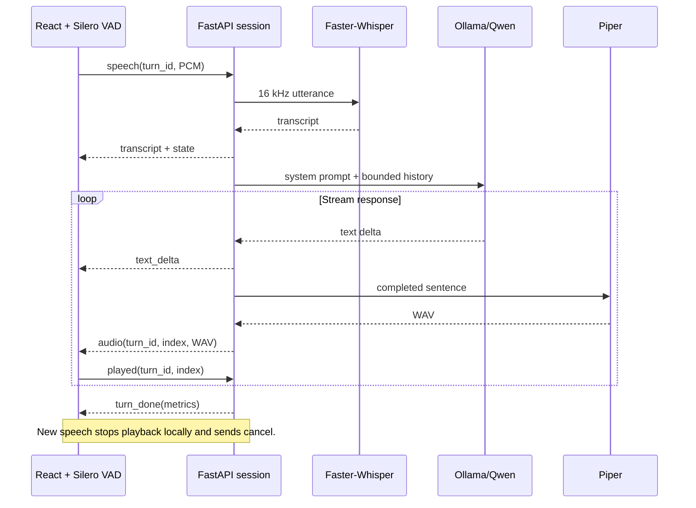

# Architecture and protocol

## Ownership

- `app/models.py`: warmup and persistent model instances, native worker executors,
  local Ollama streaming HTTP client. No user-selectable external inference URL.
- `app/conversation.py`: one active turn per WebSocket, bounded producer/consumer queue,
  two-chunk playback window, cancellation, turn metrics, and spoken history.
- `app/core.py`: validated little-endian audio, silence gate, sentence segmentation, history.
- React reducer owns visible conversation state. VoiceClient owns browser resources and
  uses a generation counter to invalidate asynchronous startup and stale turn events.
- AudioPlayer invalidates pending decode results, stops active sources, and acknowledges
  only naturally completed chunks. VAD stays active while assistant speech plays.

## WebSocket /ws/conversation

All frames are JSON. Audio is base64 to keep the small local protocol inspectable.
Input PCM is little-endian signed 16-bit, mono, 16 kHz, at most 30 seconds.
Use monotonically increasing non-negative integer turn IDs for the life of a connection.

| Direction | Type | Fields |
|---|---|---|
| Client → server | speech | turn_id, pcm |
| Client → server | cancel | none; cancel active turn |
| Client → server | reset | none; cancel and clear history |
| Client → server | played | turn_id, index; completed playback only |
| Server → client | state | turn_id, state: transcribing/generating |
| Server → client | transcript | turn_id, text |
| Server → client | text_delta | turn_id, text |
| Server → client | audio | turn_id, index, text, wav |
| Server → client | turn_done | turn_id, metrics |
| Server → client | empty | turn_id; silence/no transcript |
| Server → client | reset | none |
| Server → client | error | message, optional turn_id |

`turn_done` means server synthesis is finished, not that browser playback finished.
The UI returns to listening status only after its audio queue drains. Incoming speech
interrupts any processing stage. Old-turn events never resume playback.

Playback acknowledgements are strictly sequential and only accepted for sent chunks in
the active history turn. On cancellation, later acknowledgements are ignored. A clipped
partial sentence is excluded from context rather than pretending the complete text was heard.

## Deployment boundary

Bind to 127.0.0.1. WebSocket origins are restricted to localhost ports 8000 and 5173.
React renders transcript strings as text. No authentication is implemented for public
deployment; do not expose this local development application on a public interface.
No database, transcript logging, cloud API keys, or runtime CDN requests are required.
